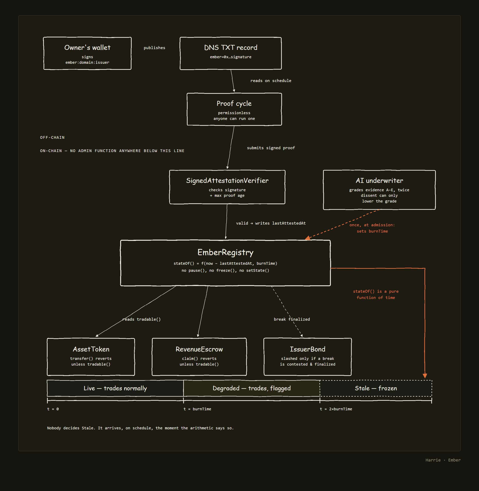

# Ember

**An ember dies unless it is fed.**

A verification primitive for real-world assets on BOT Chain. Every tokenized asset burns
for a set time on one proof. Feed it fresh evidence and it keeps burning. Stop, and it
goes out — not because an administrator froze it, but because the state that permits
trading is derived from evidence freshness and simply stops being true.

Track: **RWA Applications**. AI is the origination and risk-parameterization engine, not
a chatbot bolted onto the front end.

[**Live site**](https://ember-rwa.vercel.app) · [Dashboard](https://ember-rwa.vercel.app/dashboard) · [Docs](https://ember-rwa.vercel.app/docs) · [List an asset](https://ember-rwa.vercel.app/list) · [Explorer](https://scan.botchain.ai)



---

## The core idea

Most real-world asset tokens work like this: someone verifies an asset once, mints a
token, and then the token keeps trading indefinitely, even if the asset is no longer
valid. A domain token could keep trading months after the domain has expired, because
nobody is checking it again.

Ember takes a different approach. Every asset has to keep proving that it is still valid.
If the proof stops, the asset eventually stops trading automatically. There is no admin
who can freeze it — the contract does not even have a freeze function. Its state is
determined by simple math: how long it has been since the last valid proof. No proof
means no fresh state, and the asset eventually becomes untradable.

## The lifecycle of an asset

**1. Prove you own it.** Right now Ember uses domains, because ownership can be checked
publicly through DNS. You sign a message with your wallet —
`ember:yourdomain.com:0xYourAddress` — and publish that signature as a DNS TXT record on
your domain. Anyone can verify it themselves with `dig` and `ethers.verifyMessage` to
confirm you control both the domain and the wallet. No Ember account needed.

**2. Register it on-chain.** Your wallet calls the registry contract directly and pays the
gas. There is no approval process — anyone can register an asset.

**3. AI underwrites it.** This is currently the only gate. A model looks at deterministic
facts about the domain — age, expiry date, DNS configuration, HTTP reachability — and
grades it A through E. That grade maps to a public table that sets the asset's burn time:
how long a single proof keeps it fresh. An old, stable domain might get six hours; a
brand-new one might get ninety seconds. A second model reviews the first grade and can
only make it stricter, never more lenient. Once this runs, the burn time is written
on-chain and an NFT representing the asset is minted.

**4. Keep proving it.** A background process rechecks the DNS record on a schedule and
submits a new proof on-chain when it succeeds. Anyone can submit these proofs and earn a
small reward, so Ember does not depend entirely on its own relayer — if it goes offline,
someone else can keep the system alive.

**5. Let time determine the state.** The contract runs one calculation:

```
age = now - lastProofTime

if   age <= burnTime      -> Live       (trades normally)
elif age <= burnTime * 2  -> Degraded   (trades, flagged)
else                      -> Stale      (transfers blocked)
```

Nobody flips a switch. If the proof stops — the DNS record was deleted, the domain
expired, the relayer went offline — the asset simply gets older until it crosses the
deadline and stops being tradable. That's the entire mechanism.

## What happens when an asset goes bad

Once an asset is Stale, its transfers revert — the NFT cannot move. Any revenue held in
escrow for it stops paying out to the holder and stays locked.

If someone believes the asset is not just stale but actually **Broken** — the domain was
hijacked, turned into a scam page — they can formally propose that. It goes through a
contestable window before it can be finalized. If it is finalized broken, the issuer's
bond is slashed to the holder of the now-worthless token, who can redeem it to release
whatever revenue was sitting in escrow.

Verification detects the problem. The bond and escrow are what provide the compensation —
those are two different jobs, done by two different mechanisms.

## The five contracts

- **EmberRegistry** — the brain. Tracks every asset and derives its state with pure math.
  No freeze, no pause.
- **SignedAttestationVerifier** — checks that a submitted proof carries a valid signature
  from an approved verifier and isn't too old to replay.
- **AssetToken** — an ERC-721. Its transfer function checks the registry first and
  reverts if the asset isn't fresh. That check is the entire enforcement mechanism.
- **IssuerBond** — collateral posted at admission, slashable to the holder if the asset is
  finalized broken.
- **RevenueEscrow** — holds revenue an asset earns (parking, lease income). Claimable by
  the holder while fresh; held otherwise.

## Where trust actually sits

Ember is not fully decentralized yet, and that's worth being clear about.

The **underwriter** role — who can admit assets and set their burn times — currently
relies on one key. The **verifier signing key** is allowlisted: anyone can submit a proof,
but only approved verifiers can currently sign one. There is also **one arbiter** handling
contested broken claims instead of a jury.

These are known limitations, not hidden ones. The plan is a staked, open verifier set and
a jury system — pieces that haven't been rushed before they can be built safely.

## Why BOT Chain

The system depends on proofs being submitted on schedule. On a normal EIP-1559 chain, gas
prices move unpredictably — if gas spikes and a proof gets missed, the chain can't tell
the difference between an asset that genuinely went bad and one whose proof was simply too
expensive to submit that minute.

BOT Chain runs a flat 20 gwei fee with no base fee, removing that auction entirely. Blocks
land roughly every 0.75 seconds, so a state change is reflected almost immediately rather
than rounded to a slower chain's block time.

## Deployed on BOT Chain Mainnet

| Contract | Address |
|---|---|
| EmberRegistry | [`0x743ecCd95655b42756bB66bE30F5d07c46349936`](https://scan.botchain.ai/address/0x743ecCd95655b42756bB66bE30F5d07c46349936) |
| AssetToken | [`0xBAd328f91418E7725084Ab0D026F4D91800cA989`](https://scan.botchain.ai/address/0xBAd328f91418E7725084Ab0D026F4D91800cA989) |
| SignedAttestationVerifier | [`0x0E8B4F9670fA4942382C77ADD76d9A97840ba6f9`](https://scan.botchain.ai/address/0x0E8B4F9670fA4942382C77ADD76d9A97840ba6f9) |
| IssuerBond | [`0x80B4a168913A4Df539D01496601E1Febb6593FCe`](https://scan.botchain.ai/address/0x80B4a168913A4Df539D01496601E1Febb6593FCe) |
| RevenueEscrow | [`0xE99f93a33B2457690262Dc04ea9964C82AC10C36`](https://scan.botchain.ai/address/0xE99f93a33B2457690262Dc04ea9964C82AC10C36) |
| RevenueEscrowV2 | [`0x6a2D70F6540e1b49eA477125E3a2E66471b6B790`](https://scan.botchain.ai/address/0x6a2D70F6540e1b49eA477125E3a2E66471b6B790) |

Chain ID `677`, RPC `https://rpc.botchain.ai`. Nothing above is a placeholder — every
address is live and every function callable exactly as shown on the block explorer.

`RevenueEscrowV2` adds automatic fee-routing into the relay reward pool, so permissionless
relay funds itself from revenue rather than manual top-ups. It is deployed and tested but
**the frontend still reads V1** — V2 is not yet the active revenue path, and this note will
go away when it is.

## Grading table

| Grade | Burn time | Reading |
|---|---|---|
| A | 6 hours | long history, registry-locked, stable operation |
| B | 3 hours | established, minor weaknesses |
| C | 1 hour | ordinary, unremarkable evidence |
| D | 15 minutes | thin history or a missing lock |
| E | 90 seconds | no history, or evidence about to lapse |

The model never writes a number to the chain — it picks a letter from five, and the
mapping from letter to seconds is code anyone can read.

## Self-serve listing

Listing an asset does not require us. At [`/list`](https://ember-rwa.vercel.app/list),
any wallet can:

1. Sign the control message and get the exact DNS TXT record to publish.
2. Register the domain directly on-chain (`EmberRegistry.register`, permissionless) — this
   is the user's own transaction from their own wallet, and nobody can block it.
3. The proof cycle discovers the new asset on-chain automatically (it reads the registry
   rather than a hardcoded list) and reports it as awaiting underwriting.

**Admission is still a manual step.** Registration is permissionless, but the underwriter
must then run `npm run underwrite -- <domain>` to grade the asset and write its burn time.
That gate is deliberate for now — unattended admission would let anyone register arbitrary
domains and spend the underwriter's gas and model budget at will. Making admission
permissionless needs a fee or stake to make abuse expensive, and that is roadmap, not
shipped.

## What this does not do

- **No registrar integration.** A token is a claim on a continuously monitored asset, not
  automated transfer of the domain itself. An issuer bond is the economic substitute.
- **No secondary marketplace.** Assets transfer directly; there is no listing contract yet.
- **Model output is an estimate, not an appraisal.** Every memo cites the evidence it
  relied on so a reader can check it and disagree.
- **DNS is the root of trust.** A compromised registrar account is reported, not prevented.

The full list, with reasoning for each limit, is on the [docs page](https://ember-rwa.vercel.app/docs).

## Repository layout

```
contracts/       EmberRegistry, AssetToken, IssuerBond, RevenueEscrow, verifiers
agent/           proof cycle, underwriter, evidence collection, chain plumbing
  lib/           evidence.js, grading.js, model.js, chain.js, canonical.js, publish.js
scripts/         deploy.js, keys.js, gas.js
test/            53 tests: contracts, evidence, grading, underwriting, full e2e harness
web/             Next.js frontend — landing page, dashboard, asset detail, self-serve /list, /docs
deployments/     addresses written by scripts/deploy.js, one file per network
docs-assets/     architecture.png
PROJECT.md       full architecture writeup
```

## Running it locally

Requires Node 18+.

```bash
npm install
cp .env.example .env        # fill in DEPLOYER_KEY, VERIFIER_KEY at minimum
npm test                    # 53 tests: contracts, agent, full e2e harness
```

**Deploy to a local Hardhat network:**

```bash
npm run deploy:local
```

**Deploy to BOT Chain mainnet** (requires a funded `DEPLOYER_KEY`):

```bash
npm run deploy:botchain
```

**List and verify a real domain from the CLI:**

```bash
npm run prove -- example.com          # prints the TXT record to publish
npm run underwrite -- example.com     # grades it and admits it on-chain
```

**Run the proof cycle:**

```bash
npm run cycle              # continuous
npm run cycle:once --dry   # one pass, no transaction
```

**Run the frontend:**

```bash
cd web
npm install
npm run dev
```

## Measured, not asserted

Every number below is reproducible from `scripts/gas.js` or a live read against the
deployed contracts — none of it is a projection.

| | |
|---|---|
| Gas per attestation | 79,660 (0.0016 BOT at 20 gwei) |
| Batched, 3 assets | 33.7% cheaper per asset |
| Block time | 0.75s, measured over 20 blocks |
| Tests | 53, all passing — contracts, agent, and full end-to-end |
| Admin functions that can pause, freeze, or extend an asset's clock | 0 |

## The idea worth remembering

Most RWA projects ask you to trust their verification. Ember asks you to verify it
yourself: check the DNS record with `dig`, check the signature with
`ethers.verifyMessage`, check the contract state on the explorer.

The AI's role is deliberately narrow. It decides how often an asset needs to prove itself,
once, at admission. After that, it does not decide whether the asset is fresh — time and
on-chain math do, and anyone can check the answer without asking permission.

## License

MIT — see [`LICENSE`](LICENSE).
